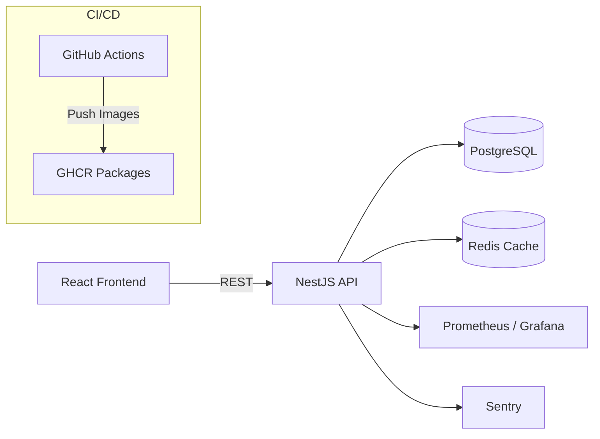

# Customer Feedback Dashboard

A full-stack customer feedback dashboard built with **React (TypeScript)** on the frontend and **NestJS** with **PostgreSQL** on the backend.  
This app is fully containerized with **Docker**, tested and built via **GitHub Actions**, and published to **GitHub Packages (GHCR)**.  
Optimized for scalability, caching, and observability.

---

## 🧩 Tech Stack

**Frontend:** React + TypeScript  
**Backend:** NestJS + TypeORM + PostgreSQL  
**Infrastructure:** Docker, GitHub Actions (CI/CD), GHCR Registry  
**Performance:** Redis caching, DB indexing  
**Monitoring:** Prometheus, Grafana, Sentry

---

## 📦 Project Structure

```
customer-feedback-dashboard/
├── backend/               # NestJS app
├── frontend/              # React app
├── .github/workflows/ci.yml
├── docker-compose.yml     # Dev stack
├── docker-compose.prod.yml
├── .env.example
└── README.md
```

---

## 🚀 Quick Start (Local Development)

### 1. Clone & Configure

```bash
git clone https://github.com/your-org/customer-feedback-dashboard.git
cd customer-feedback-dashboard
cp .env.example backend/.env
```

Update values in `.env` (especially DB credentials and secrets).

### 2. Start the stack

```bash
docker-compose up --build
```

Frontend → http://localhost:3000  
Backend API → http://localhost:4000

---

## 🧪 Run Tests

```bash
# backend
cd backend
npm ci && npm test

# frontend
cd frontend
npm ci && npm test
```

---

## 🐳 Production Deployment with GHCR

### 1. Log in to GHCR

In your CI/CD or local terminal:

```bash
echo ${{ secrets.GITHUB_TOKEN }} | docker login ghcr.io -u USERNAME --password-stdin
```

### 2. Build & Push Images

```bash
docker build -t ghcr.io/<your-username>/<repo-name>:backend-latest ./backend
docker push ghcr.io/<your-username>/<repo-name>:backend-latest

docker build -t ghcr.io/<your-username>/<repo-name>:frontend-latest ./frontend
docker push ghcr.io/<your-username>/<repo-name>:frontend-latest
```

### 3. Deploy via Docker Compose (Production)

```bash
docker-compose -f docker-compose.prod.yml up -d
```

This will start:
- PostgreSQL
- Redis
- Backend API (NestJS)
- Frontend (React)
- Traefik reverse proxy (for routing)

---

## 🔐 GitHub Packages / GHCR Setup

1. Go to your GitHub repository → **Settings → Packages → Personal Access Tokens**
2. Generate a classic PAT with **write:packages** and **read:packages**
3. Add these secrets in your GitHub repo under **Settings → Secrets → Actions**:
   - `REGISTRY_USER`: your GitHub username
   - `REGISTRY_TOKEN`: your PAT token
4. GitHub Actions workflow (`.github/workflows/ci.yml`) automatically logs in, builds, and pushes Docker images on each `main` push.

---

## 📊 Monitoring & Observability

- **Prometheus** scrapes `/metrics` endpoint from backend.
- **Grafana** dashboards visualize latency, error rates, and throughput.
- **Sentry** captures errors and performance traces.

Example Prometheus scrape target:

```yaml
- job_name: 'feedback-api'
  static_configs:
    - targets: ['api:4000']
```

---

## 📈 Performance Optimizations

- PostgreSQL indexes on frequent filters (`status`, `createdAt`, etc.)
- Redis caching for list endpoints with key invalidation
- Cursor pagination for large datasets
- Connection pooling and query optimization

---

## 📄 License

MIT License © 2025 Ibrahim Al Tuwayhir

---

## 🧠 Architecture Diagram (Mermaid)


